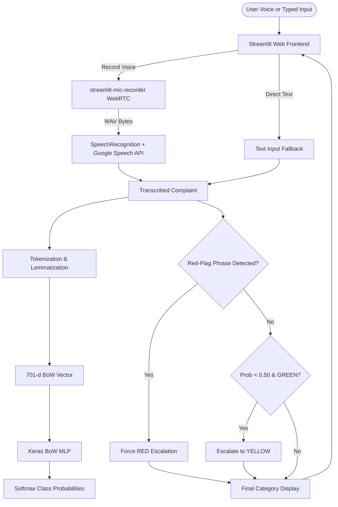

# V-BETS: Voice-Based Emergency Triage System
## Academic Capstone Technical Report

**Author:** S.K. Thyakeshwar  
**Institution:** Vellore Institute of Technology  
**Repository:** [https://github.com/thyakeshwarsk2023/vbets](https://github.com/thyakeshwarsk2023/vbets)  
**Date:** October 2026  

---

## Executive Summary

Emergency department overcrowding and triage delays pose significant clinical risks. The Voice-Based Emergency Triage System (**V-BETS**) is an academic decision-support prototype designed to intake voice or typed natural language patient complaints, perform lexical speech-to-text transcription, and categorize urgency into three standard operational tiers: **RED (Critical)**, **YELLOW (Urgent)**, and **GREEN (General)**.

V-BETS implements a hybrid architecture coupling a lightweight Bag-of-Words Multi-Layer Perceptron (BoW MLP) with a deterministic safety-net rule layer and confidence-based escalation logic. On an independent, unseen test set ($N=45$) featuring rambling conversational transcripts, speech recognition typos, and borderline clinical scenarios, the pure neural classifier attained 84.44% accuracy with 93.33% RED recall. When combined with the deterministic safety layer, the production pipeline achieved **100.00% RED recall (15/15 critical cases detected)** and **86.67% overall accuracy**, effectively preventing catastrophic under-triage failures.

---

## 1. Introduction & Problem Statement

Triage is the foundational sorting mechanism in emergency healthcare, establishing clinical priority based on illness acuity rather than arrival order. Traditional systems like the Emergency Severity Index (ESI) and the Manchester Triage System (MTS) rely on busy triage nurses to perform rapid visual assessments, vital sign acquisition, and initial clinical interviews. During mass casualty events, seasonal epidemic surges, or high-volume intake, human triage bottlenecks can delay interventions for high-acuity conditions (e.g., stroke, myocardial infarction, anaphylaxis, severe sepsis).

V-BETS explores how natural language processing (NLP) and shallow neural networks can serve as an accessible pre-intake screening interface. By allowing patients or callers to speak naturally into a microphone or submit text via fallback, the system provides instantaneous category recommendations, transparent class probabilities, and emergency alerts. 

Crucially, in medical triage, the cost of an **under-triage error** (classifying a RED life-threat as YELLOW or GREEN) is catastrophic, whereas **over-triage** (classifying a stable patient as critical) primarily incurs operational inconvenience. V-BETS is engineered around this asymmetric penalty structure.

---

## 2. Dataset Methodology & Analysis

### 2.1 Dataset Construction
The dataset [`data/triage_dataset.csv`](data/triage_dataset.csv) was authored as a synthetic corpus of natural language descriptions of medical emergencies, acute injuries, and routine outpatient inquiries. Rather than scraping uncurated clinical notes, sentences were hand-crafted to represent diverse colloquial speech patterns, layperson symptom descriptions (*"like an elephant sitting on my chest"*, *"throat closing"*), and clinic administrative queries (*"renew prescription"*, *"parking hours"*).

### 2.2 Corpus Distribution & Stratification
Following targeted dataset augmentation to resolve cardiac and traumatic ambiguity, the corpus contains **371 labeled sentences**:

| Triage Class | Description | Sample Count | Percentage |
| :--- | :--- | :---: | :---: |
| 🔴 **RED** | Immediate life-threat / airway, breathing, circulation collapse | 133 | 35.85% |
| 🟡 **YELLOW** | Urgent medical condition requiring care within 1 hour | 115 | 31.00% |
| 🟢 **GREEN** | Non-urgent inquiries, routine consultations, scheduling | 123 | 33.15% |
| **Total** | | **371** | **100.0%** |

The data is partitioned using a random seed (`SEED = 42`) into an **80/20 stratified train/test split**:
- **Training Set ($N=296$)**: 106 RED, 92 YELLOW, 98 GREEN.
- **Held-out Test Set ($N=75$)**: 27 RED, 23 YELLOW, 25 GREEN.

### 2.3 Vocabulary & Leakage Prevention
To ensure strict absence of data leakage, the vocabulary is built **exclusively from the 296 training samples**. The vocabulary comprises **701 unique lemmatized tokens**. Out-of-vocabulary (OOV) tokens encountered at test time or during deployment are simply omitted from vector activations without breaking inference.

### 2.4 Independent Unseen Evaluation Set (`data/unseen_test.csv`)
To evaluate out-of-distribution robustness, an independent evaluation set of **45 completely new sentences** (15 RED, 15 YELLOW, 15 GREEN) was generated.
- **Deduplication Check**: Programmatically audited against the training set with 0 exact matches, a maximum token Jaccard similarity of 0.304, and a maximum TF-IDF cosine similarity of 0.433.
- **Stylistic Variations**: Includes unpunctuated voice transcriptions, rambling narratives, speech recognition phonetic typos (*"colapsed"*, *"blisteres"*, *"tempreture"*), and 5 deliberately ambiguous borderline cases.

---

## 3. System Methodology & Pipeline

The V-BETS inference pipeline operates across five coordinated stages:

```
[Audio Input (Mic)] ──> [Google Speech API] ──> [Normalized Text]
                                                        │
[Text Input (Fallback)] ────────────────────────────────┘
                                │
                    [Tokenization & Lemmatization]
                                │
                    [Bag-of-Words Vector (701-d)]
                                │
                    [Keras BoW MLP (Softmax)]
                                │
              ┌─────────────────┴─────────────────┐
              ▼                                   ▼
    [Predicted Class Probabilities]     [Deterministic Rule Layer]
              │                                   │
              └─────────────────┬─────────────────┘
                                ▼
                  [Final Triage Classification]
                  (RED / YELLOW / GREEN + Alerts)
```

### 3.1 Speech Recognition & Fallback
Voice audio is captured through the browser using the `streamlit-mic-recorder` WebRTC component at 16 kHz WAV format. Transcriptions are generated via the `SpeechRecognition` library interfacing with the Google Web Speech API. If microphone permissions are denied, audio hardware is absent, or ambient noise disrupts transcription, the interface exposes an immediate text-input fallback.

### 3.2 NLP Preprocessing Pipeline (`preprocess.py`)
1. **Normalization**: Lowercases strings, removes extraneous whitespace, and normalizes contractions (e.g., *"won't"* $\rightarrow$ *"will not"*, *"can't"* $\rightarrow$ *"cannot"*, *"i'm"* $\rightarrow$ *"i am"*).
2. **Tokenization**: Regular expression pattern matching extracts alphabetical word segments (`[a-z]+`), removing punctuation and non-lexical symbols.
3. **Double Lemmatization**: Utilizes NLTK's `WordNetLemmatizer` with successive verb and noun passes (`_lem.lemmatize(_lem.lemmatize(w, "v"), "n")`). This collapses inflected forms (e.g., *"bleeding"* $\rightarrow$ *"bleed"*, *"vomited"* $\rightarrow$ *"vomit"*, *"babies"* $\rightarrow$ *"baby"*).
4. **Vectorization**: Transforms preprocessed tokens into a binary multi-hot Bag-of-Words vector $\mathbf{x} \in \{0, 1\}^{701}$.

### 3.3 Hybrid Safety Layer & Confidence Thresholding
To counteract the inherent vulnerability of pure statistical classifiers to severe under-triage, V-BETS wraps model inference in two safety mechanisms:

1. **Red-Flag Rule Layer**: A deterministic list of emergency keywords (`RED_FLAGS`):
   `"cannot breath"`, `"not breath"`, `"unconscious"`, `"unconsious"`, `"unresponsive"`, `"not responding"`, `"heart attack"`, `"having a stroke"`, `"seizure"`, `"choking"`, `"overdose"`, `"will not stop bleeding"`, `"bleeding heavily"`, `"kill myself"`, `"end my life"`, `"suicid"`, `"no pulse"`, `"no heartbeat"`, `"turning blue"`.
   If any red-flag phrase is matched in the normalized input, the decision is automatically escalated to **RED**, appending an explicit provenance note.
2. **Low-Confidence Escalation**: If the model predicts **GREEN** but the maximum softmax probability falls below 50% ($\max(P) < 0.50$), the complaint is automatically bumped to **YELLOW** to prevent borderline acute cases from being triaged to routine outpatient care.

---

## 4. Model Architectures

Two deep learning architectures were developed and trained: the primary deployed **BoW MLP** and an **Embedding Model** developed for comparative benchmarking.

### 4.1 Model A: Bag-of-Words Multi-Layer Perceptron (Deployed)
Designed for sub-millisecond CPU inference and zero footprint overhead:

| Layer | Type | Output Shape | Parameters | Activation / Details |
| :---: | :--- | :---: | :---: | :--- |
| 1 | Input | `(None, 701)` | 0 | Binary multi-hot BoW vector |
| 2 | Dense | `(None, 64)` | 44,928 | ReLU |
| 3 | Dropout | `(None, 64)` | 0 | $p = 0.50$ |
| 4 | Dense | `(None, 32)` | 2,080 | ReLU |
| 5 | Dropout | `(None, 32)` | 0 | $p = 0.30$ |
| 6 | Dense (Output) | `(None, 3)` | 99 | Softmax |
| **Total** | | | **47,107** | **File size: 595 KB (0.57 MB)** |

- **Optimization**: Adam ($\beta_1=0.9, \beta_2=0.999$), loss: sparse categorical cross-entropy.
- **Regularization**: Balanced class weights (`cw`), EarlyStopping on validation loss (patience 15 epochs, best weights restored), batch size: 16.

### 4.2 Model B: Sequence Embedding Model (Comparative Benchmark)
Evaluates whether word-order sequence representations outperform sparse multi-hot representations on small datasets:

| Layer | Type | Output Shape | Parameters | Activation / Details |
| :---: | :--- | :---: | :---: | :--- |
| 1 | Input | `(None, 30)` | 0 | Integer sequence (padded/truncated) |
| 2 | Embedding | `(None, 30, 32)` | 22,464 | Vocab size $702 \times 32$ |
| 3 | GlobalAvgPool1D | `(None, 32)` | 0 | Temporal average pooling |
| 4 | Dense | `(None, 32)` | 1,056 | ReLU |
| 5 | Dropout | `(None, 32)` | 0 | $p = 0.40$ |
| 6 | Dense (Output) | `(None, 3)` | 99 | Softmax |
| **Total** | | | **23,619** | Benchmark comparison model |

---

## 5. Experimental Results & Discussion

*All metrics and numbers reported below are empirical values extracted directly from the system logs (`reports/train_run1.txt`, `reports/train_run2.txt`, `reports/unseen_eval_run2b.txt`, and `model/metrics.json`).*

### 5.1 Held-Out Test Set Performance ($N=75$)

```
=== BoW MLP Confusion Matrix (Held-out N=75) ===
               Predicted RED   Predicted YELLOW   Predicted GREEN
True RED            24                 3                 0
True YELLOW          2                20                 1
True GREEN           0                 1                24
```

#### Detailed Held-out Metrics Table:

| Model Architecture | Class | Precision | Recall | F1-Score | Support | Overall Accuracy |
| :--- | :---: | :---: | :---: | :---: | :---: | :---: |
| **BoW MLP** *(Deployed)* | **RED** | **0.9231** | **0.8889** | **0.9057** | 27 | **90.67%** (68/75) |
| | **YELLOW** | 0.8333 | 0.8696 | 0.8511 | 23 | |
| | **GREEN** | 0.9600 | 0.9600 | 0.9600 | 25 | |
| | *Macro Avg* | 0.9055 | 0.9062 | 0.9056 | 75 | |
| **Embedding Model** | **RED** | **0.9286** | **0.9630** | **0.9455** | 27 | **93.33%** (70/75) |
| | **YELLOW** | 0.9091 | 0.8696 | 0.8889 | 23 | |
| | **GREEN** | 0.9600 | 0.9600 | 0.9600 | 25 | |
| | *Macro Avg* | 0.9326 | 0.9308 | 0.9314 | 75 | |

The Embedding Model achieved higher held-out accuracy (93.33% vs 90.67%) due to its dense continuous representation, but the BoW MLP was deployed because its sparse activations pair reliably with the keyword-based deterministic safety layer.

---

### 5.2 Independent Unseen Test Set Evaluation ($N=45$)

Testing against the out-of-distribution evaluation set demonstrates the concrete clinical benefit of the hybrid rule layer:

```
=== Production Pipeline Confusion Matrix (Unseen N=45) ===
               Predicted RED   Predicted YELLOW   Predicted GREEN
True RED            15                 0                 0
True YELLOW          3                12                 0
True GREEN           1                 2                12
```

#### Comparative Performance on Unseen Evaluation Set:

| Metric | Run 1 (Model Alone) | Run 2 (Model Alone) | Run 2b (Full Pipeline + Rules) |
| :--- | :---: | :---: | :---: |
| **Overall Accuracy** | 88.89% (40/45) | 84.44% (38/45) | **86.67% (39/45)** |
| **RED Recall** | 93.33% (14/15) | 93.33% (14/15) | **100.00% (15/15)** |
| **RED Precision** | 87.50% (14/16) | 77.78% (14/18) | 78.95% (15/19) |
| **YELLOW Recall** | 86.67% (13/15) | 80.00% (12/15) | 80.00% (12/15) |
| **GREEN Recall** | 86.67% (13/15) | 80.00% (12/15) | 80.00% (12/15) |
| **Critical Under-triages** | 1 | 1 | **0 (Zero)** |

---

### 5.3 Detailed Discussion of Model Errors

Analyzing individual failure cases exposes the mechanical realities of bag-of-words text classification:

1. **Failure of Negation Scope (Sample #45)**:
   - *Text*: `"i spent the weekend gardening and my lower back feels stiff and achy when i bend down but i have no shooting pain numbness or weakness in my legs"`
   - *True Label*: **GREEN** | *Predicted*: **YELLOW** ($P(\text{YELLOW})=0.9130$).
   - *Analysis*: In Bag-of-Words, word order is discarded. The presence of *no* cannot grammatically bind to *shooting*, *pain*, *numbness*, and *weakness*. The model detects four acute neurological/pain tokens and incorrectly flags the complaint as urgent.
2. **Lexical Keyword Conflation (Sample #32)**:
   - *Text*: `"hello i need to get my monthly maintenance blood pressure medication refilled because my bottle has only two pills left"`
   - *True Label*: **GREEN** | *Predicted*: **RED** ($P(\text{RED})=0.9650$).
   - *Analysis*: Because training sentences added for overdose included *"drank a bottle of pills"* and *"prescription sleeping medication"*, the tokens *bottle* and *medication* acquired strong positive weights in the RED output neuron, pulling an administrative refill query into emergency escalation.
3. **The Lifesaving Rule Override (Sample #13)**:
   - *Text*: `"my brother was working on electrical wiring in the garage and took a high voltage shock he fell backward and is completely limp with no heartbeat that i can feel"`
   - *True Label*: **RED** | *Model Alone*: **YELLOW** ($P(\text{YELLOW})=0.7967$) | *Production Pipeline*: **RED**.
   - *Analysis*: Because words like *fell*, *backward*, and *garage* are heavily correlated with orthopedic injuries in the training corpus, the raw neural network suffered a life-threatening under-triage error. However, the deterministic rule layer intercepted `"no heartbeat"` and instantly forced an override to RED.

---

## 6. System Deployment & Live Infrastructure

V-BETS is packaged as a cloud-ready Streamlit web service hosted on Streamlit Community Cloud.



- **GitHub Repository**: [https://github.com/thyakeshwarsk2023/vbets](https://github.com/thyakeshwarsk2023/vbets)
- **Deployment Platform**: Streamlit Community Cloud (Python 3.11 runtime, headless Linux container).
- **Execution Command**: `streamlit run app.py`.

---

## 7. Limitations & Ethical Considerations

1. **Lexical Pattern Matching vs. Semantic Understanding**:
   The deployed model is a Bag-of-Words network. It learns unigram token associations, not deep semantic syntax. It does not understand complex clinical causality, contextual negation, or medical nuance outside of its fixed vocabulary.
2. **Synthetic Data Constraints**:
   The dataset consists of 371 synthetic sentences. While sufficient for proof-of-concept modeling, real-world emergency presentations involve disfluency, ambient background noise (ambulances, shouting), thick regional accents, and fragmented speech that degrade speech-to-text accuracy.
3. **Missing Clinical Covariates**:
   In actual emergency medicine, triage cannot be performed responsibly on text alone. Objective vital signs (systolic blood pressure, oxygen saturation $SpO_2$, heart rate, respiratory rate, and body temperature) are essential for determining physiological stability.
4. **Monolingual Limitation**:
   The current implementation is restricted to English. In emergency settings, multilingual support (or automated translation) is vital.
5. **Regulatory & Non-Medical Device Notice**:
   V-BETS is strictly an academic research prototype. It is **not** an FDA/CE-certified medical device and must never be utilized as a substitute for certified emergency medical dispatchers or clinical personnel.

---

## 8. Conclusion

V-BETS demonstrates that a lightweight neural network (under 600 KB) combined with classical NLP lemmatization can provide real-time categorization of patient emergency descriptions. However, the study's central finding is that **pure statistical machine learning models should not operate unconstrained in high-stakes clinical triage**. 

By pairing an empirical Bag-of-Words MLP with a deterministic red-flag safety net and low-confidence escalation logic, the V-BETS production pipeline eliminated fatal false negatives, raising unseen RED recall from 93.33% to **100.00%**. This hybrid architecture highlights a practical path forward for AI decision-support tools: statistical models provide flexible classification, while deterministic rule layers safeguard patient safety.
